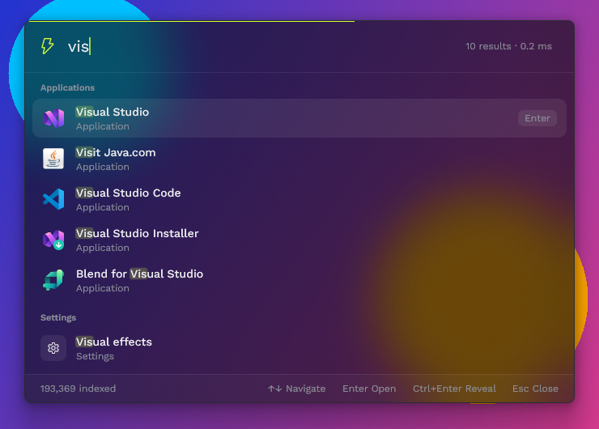
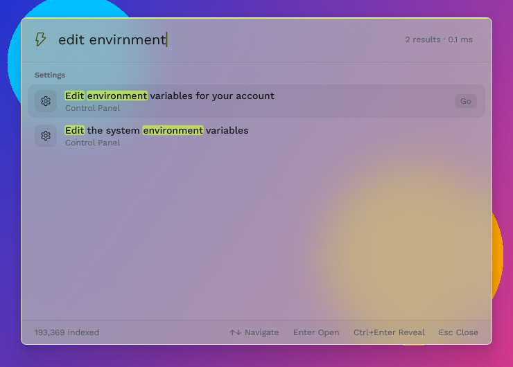
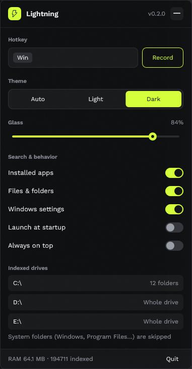

<p align="center">
  
</p>

<h1 align="center">Lightning</h1>

<p align="center">
  <b>A lightning-fast launcher for Windows.</b><br>
  Press <kbd>Alt</kbd>+<kbd>Space</kbd>, type, hit <kbd>Enter</kbd>: apps, files on every drive, and Windows settings.
</p>

<p align="center">
  <a href="https://github.com/sashpawar11/lightning/releases/latest"></a>
  <a href="https://github.com/sashpawar11/lightning/releases"></a>
  <a href="LICENSE"></a>
  
  
</p>

<p align="center">
  
  
</p>

## Features

- **Everything in one box:** installed apps (classic and Store), files on every fixed drive, Windows Settings pages and ~200 Control Panel tasks ("edit environment variables", "adjust system volume").
- **Fast:** apps and settings answer in microseconds, files in milliseconds across ~200k files, all on a background thread so typing never stutters.
- **Forgiving:** word-aware fuzzy matching (`vsc` → Visual Studio Code) and typo tolerance (`volumne control` → Volume mixer). Things you open often rank first.
- **Light on memory:** ~45 MB idle including the full file index; no GPU device in the process.
- **Looks native:** frosted-glass panel with adjustable strength, automatic light/dark theme, Work Sans typography, real app and file icons.
- **Lives in the tray:** a small settings panel for hotkey, theme, glass, sources, start at sign-in and always-on-top.



## Install

1. Download **`Lightning-Setup-<version>.exe`** from the [latest release](https://github.com/sashpawar11/lightning/releases/latest).
2. Run it. No admin rights needed; it installs for your user only.
3. Press <kbd>Alt</kbd>+<kbd>Space</kbd>.

The installer isn't code-signed yet, so Windows SmartScreen may say *"Windows protected your PC"*. Click **More info → Run anyway**. Uninstall any time from Settings → Apps.

### Keys

| Key | Action |
| --- | --- |
| <kbd>Alt</kbd>+<kbd>Space</kbd> (configurable) | Show / hide |
| <kbd>↑</kbd> <kbd>↓</kbd> <kbd>PgUp</kbd> <kbd>PgDn</kbd> | Move selection |
| <kbd>Enter</kbd> | Open |
| <kbd>Ctrl</kbd>+<kbd>Enter</kbd> | Reveal file in Explorer |
| <kbd>Ctrl</kbd>+<kbd>1</kbd>…<kbd>9</kbd> | Open the nth result |
| <kbd>Ctrl</kbd>+<kbd>C</kbd> | Copy the selected result's path |
| <kbd>Ctrl</kbd>+<kbd>,</kbd> | Settings |
| <kbd>Esc</kbd> | Hide (your query is kept, pre-selected) |

Left-click the tray icon for settings, right-click for the menu.

<br clear="right">

## Benchmarks

Measured on an AMD Ryzen 7 7700X, release build. Every change is checked against these numbers (see [Performance guard](#performance-guard)).

**On a real machine**: 193,000 files across 3 drives, 275 apps, 197 Control Panel tasks:

| | |
| --- | --- |
| Index all drives (warm disk cache) | **0.29 s** |
| File search, typical query | **5–19 ms** |
| Apps + settings search | **4–68 µs** |
| Memory, idle in tray (index included) | **~45 MB** |
| Memory, overlay open | **~52 MB** |
| Installer size | **4.7 MB** |

**Criterion micro-benchmarks** (median of 3 runs):

| Benchmark | Time |
| --- | --- |
| Fuzzy match, 400 apps | 26–29 µs |
| Apps + settings + Control Panel, `volumne control` | 4.5 µs |
| Apps + settings + Control Panel, `vis stu` | 12.1 µs |
| Apps + settings + Control Panel, `edit environment variables` | 68 µs |
| fff file search, 20k-file corpus | 0.54–1.6 ms |
| Index a 20k-file corpus from scratch | 158 ms |
| Enumerate installed apps | 244 ms |

## Built with

- **Rust**, in two crates: a UI-free search core and the Windows app.
- **[fff](https://github.com/dmtrKovalenko/fff)**: SIMD, typo-tolerant file search with a background file watcher.
- **Win32 + Direct2D / DirectWrite** via [`windows-rs`](https://github.com/microsoft/windows-rs): native windows, software rendering into an alpha bitmap, no web view and no GPU device.
- **DWM acrylic** for the glass effect, composited by Windows at no cost to the app.
- **Shell APIs**: `AppsFolder` for installed apps, the *All Tasks* folder for Control Panel, `ms-settings:` URIs for Settings.
- **Work Sans** typeface, embedded (SIL OFL 1.1).
- **Criterion** for benchmarks, **Inno Setup** for the installer.

## Build from source

```powershell
cargo build --release          # target\release\lightning.exe
cargo test --workspace
```

`.cargo/config.toml` enables AVX2 (`x86-64-v3`), which makes matching ~15–20%
faster. Remove it to run on CPUs without AVX2 (some Celeron/Pentium Silver).

### Release (installer)

```powershell
scripts\release.ps1                  # release the version in Cargo.toml
scripts\release.ps1 -Version 0.2.0   # bump the version, then release
scripts\release.ps1 -SkipBench       # skip the performance guard
```

Runs the tests, the performance guard and the release build, then produces
`dist\Lightning-Setup-<version>.exe` and its `.sha256` with Inno Setup
(`installer\lightning.iss`; installed per-user via winget if missing).

The installer needs no admin rights: it installs to
`%LOCALAPPDATA%\Programs\Lightning`, adds a Start menu entry, optionally starts
Lightning at sign-in and adds a desktop shortcut, and launches it when done.
Installing a newer version upgrades in place. The build embeds the app icon and
version info (`crates/lightning/build.rs`).

### Performance guard

```powershell
scripts\bench.ps1                # compare with baseline; exits 1 on regression
scripts\bench.ps1 -SaveBaseline  # accept current numbers
```

Criterion benches (`crates/lightning-core/benches/search.rs`) cover the matcher,
apps+settings search, fff search over a generated 20k-file corpus, index build
and app enumeration. A benchmark fails when it is slower than baseline by more
than 10% with 95% confidence on its first run and on two fresh re-runs (the
multi-threaded file benchmarks vary ~15% between runs of identical code); the
baseline is the per-benchmark median of 3 runs. The script also indexes the
corpus and fails if private memory grows more than 10% over
`scripts/memory-baseline.json`.

For real-machine numbers: `cargo run --release -p lightning-core --example probe`
(indexes your drives; prints counts, memory, per-query latency).

## How it works

### Layout

- `crates/lightning-core`: sources and ranking, no UI. `apps.rs` (shell
  AppsFolder: Win32 + Store apps; All Tasks folder: Control Panel tasks),
  `files.rs` (fff pickers), `settings.rs` (`ms-settings:` pages), `fuzzy.rs`
  (word-aware matcher with a precomputed bitmask filter and per-word typo
  fallback), `engine.rs` (grouping, launch history).
- `crates/lightning`: the app. `overlay.rs` (search window), `settings_ui.rs`
  (tray panel), `gfx.rs` (Direct2D/DirectWrite), `worker.rs` (search thread +
  icon extraction), `main.rs` (windows, hotkey, tray, message loop).

### What gets indexed

Every fixed drive. A drive without OS folders is indexed as one root. On the
system drive, each top-level folder is its own root and `Windows`,
`Program Files`, `ProgramData`, recovery and vendor-driver folders are skipped.
fff additionally skips hidden folders, `AppData\Local`/`Roaming`,
`node_modules`, build output and package caches, and honours `.gitignore`
inside repositories. A background watcher keeps the index current. Roots start
scanning one after another: when a dozen fff pickers start at once, some scans
intermittently never finish.

Files you have opened from Lightning rank first among file results, using the
launch history in `%LOCALAPPDATA%\Lightning\history.tsv` (fff's own LMDB
frecency database is not used). Settings live in
`%APPDATA%\Lightning\config.json`.

### Look

A translucent panel over an acrylic blur of whatever is behind it, via the
`SetWindowCompositionAttribute` accent policy. The documented
`DWMSBT_TRANSIENTWINDOW` backdrop adds its own grey tint that hides the
wallpaper. The **Glass** slider in settings sets the panel's tint over the blur.

### Behaviour

With **Always on top** (default) the overlay stays up when another window takes
focus; it hides on Esc, the hotkey, or after you open something, and when it's
visible but unfocused the hotkey brings focus back. Turn it off to have the
overlay close as soon as it loses focus.

## License

[MIT](LICENSE). The embedded Work Sans font is licensed separately under the
[SIL Open Font License 1.1](crates/lightning/assets/OFL.txt).
